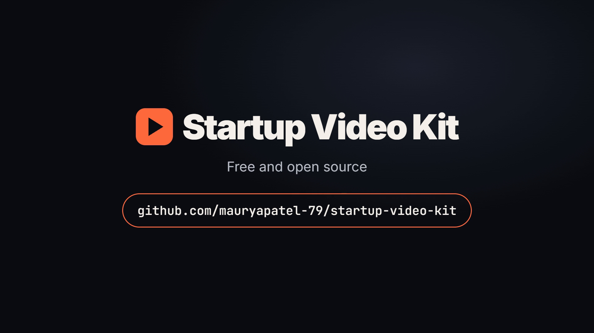

# Startup Video Kit

Make launch videos, product demos and social ads for your startup with **Claude Code, Codex, Cursor or any coding agent**. Paste your website, approve the script, get an MP4 in every format you need.

[](videos/example-launch/renders/example-launch-16x9.mp4)

*The video above was made with this kit: free local voice, word-timed captions, sound effects, rendered in about a minute on a laptop. [Watch it](videos/example-launch/renders/example-launch-16x9.mp4) · [see its source](videos/example-launch/).*

## How it works

```
your URL or brief ──► BRIEF.md ──► SCRIPT.md ──► voice + captions ──► scenes (HTML) ──► check ──► MP4 16:9 / 9:16 / 1:1
                      agent fills   you approve   free or premium      HyperFrames        lint +     + poster, .srt,
                      from your site                                    + real UI          review     hero loop
```

- **Engine:** [HyperFrames](https://github.com/heygen-com/hyperframes) (open source, by HeyGen). Agents write HTML/CSS/GSAP; it renders frame-perfect MP4.
- **Producer skill:** [`skills/startup-video`](skills/startup-video/SKILL.md) turns "make a video for my startup" into a brief, a script inside a word budget, real product screens, voice, captions, sound and every delivery format.
- **Voice:** free on-device Kokoro by default; ElevenLabs or HeyGen when you want premium.
- **Recipes:** launch film, product demo, social ad, feature announcement, explainer, hero loop, changelog. [See them](skills/startup-video/references/recipes.md).

## Quick start

Requires Node.js 22+. The setup script installs FFmpeg if it is missing.

```bash
git clone https://github.com/mauryapatel-79/startup-video-kit.git
cd startup-video-kit
```

**Windows** (clone to a short path such as `C:\dev\`, see [Troubleshooting](#troubleshooting)):

```powershell
powershell -ExecutionPolicy Bypass -File setup/setup.ps1 -LocalVoice -Captions
```

**macOS / Linux:**

```bash
bash setup/setup.sh --local-voice --captions
```

Then open the folder in your agent and ask:

```text
Make a 45-second launch video for https://your-startup.com
```

```text
/startup-video  30-second vertical ad for our new AI inbox feature, captions on, energetic
```

The agent fills a brief from your site, shows you the script, builds the scenes, opens a live preview, and renders when you approve.

**Already have a project?** Add just the skills to it, no clone needed:

```bash
npx hyperframes skills update
npx skills add mauryapatel-79/startup-video-kit
```

### Setup flags

| Windows | macOS / Linux | Adds |
| --- | --- | --- |
| `-LocalVoice` | `--local-voice` | Kokoro free voice (`pip install kokoro-onnx soundfile`, Python 3.10+) |
| `-Captions` | `--captions` | Parakeet free transcription for word-timed captions (~640 MB) |
| `-ElevenLabs` | `--elevenlabs` | ElevenLabs music + sound-effects skills |
| `-Yes` | `--yes` | Install missing system packages without asking |

### Works with

| Agent | How it picks up the kit |
| --- | --- |
| Claude Code | `CLAUDE.md` + skills in `.claude/skills/` (`/startup-video`) |
| Codex | `AGENTS.md` + skills in `.agents/skills/` |
| Cursor, Gemini CLI, Copilot | `AGENTS.md` + skills installed by `npx skills` |
| Claude.ai / ChatGPT (no install) | Add the [HyperFrames connector](https://hyperframes.heygen.com/guides/mcp) and paste [`skills/startup-video/SKILL.md`](skills/startup-video/SKILL.md) into the chat |

## Voice options

| Option | Cost | Command |
| --- | --- | --- |
| Kokoro (default) | Free, on your machine | `npx hyperframes tts --text-file narration.txt -o narration.wav` |
| ElevenLabs | From $6/mo | `node scripts/voiceover.mjs narration.txt -o narration.mp3` (writes word timings too) |
| HeyGen | 3 free min/month after sign-in | `npx hyperframes auth login`, then ask the agent |
| Your own voice | Free | Drop a recording in `assets/voice/`, the agent transcribes it |

Details: [voice.md](skills/startup-video/references/voice.md). Put keys in `.env` (copied from [.env.example](.env.example)); every key is optional.

## What's in the repo

| Path | What |
| --- | --- |
| [skills/startup-video/](skills/startup-video/) | The producer skill and its references: [recipes](skills/startup-video/references/recipes.md), [script writing](skills/startup-video/references/script.md), [voice](skills/startup-video/references/voice.md), [delivery](skills/startup-video/references/delivery.md) |
| [brief.example.md](brief.example.md) | The brief template |
| [scripts/voiceover.mjs](scripts/voiceover.mjs) | ElevenLabs voice + word timings, no dependencies |
| [setup/](setup/) | One-command setup for Windows, macOS, Linux |
| [videos/example-launch/](videos/example-launch/) | A finished project: brief, script, scenes, voice, captions, render |
| [docs/TOOLS.md](docs/TOOLS.md) | The researched stack: engines, voice, music, SFX, captions, avatars, b-roll, with prices |
| [docs/SKILLS.md](docs/SKILLS.md) | Agent skills found with `npx skills find`, vetted |

## Troubleshooting

| Problem | Fix |
| --- | --- |
| `npx hyperframes doctor` says FFmpeg missing after install | Open a new terminal so PATH refreshes. |
| Kokoro: `Error opening ... System error` on Windows | The path is over 260 characters. Move the kit to a short folder like `C:\dev\startup-video-kit`. |
| Skills not showing in Claude Code on Windows | Rerun setup; it installs with `--copy` because Windows blocks symlinks without Developer Mode. |
| `transcribe` fails on Windows | Install Parakeet (`-Captions`); whisper.cpp needs CMake and Visual Studio Build Tools. |
| HyperFrames telemetry | Anonymous by default; `npx hyperframes telemetry disable` turns it off. |

## Contributing

Issues and PRs welcome: new recipes, better scripts, more example videos. Run `npm test` before a PR that touches `scripts/`.

## License

MIT for this kit. HyperFrames is Apache-2.0. Check the licence of every voice, music track and sound you use; each example lists its sources in `CREDITS.md`.
